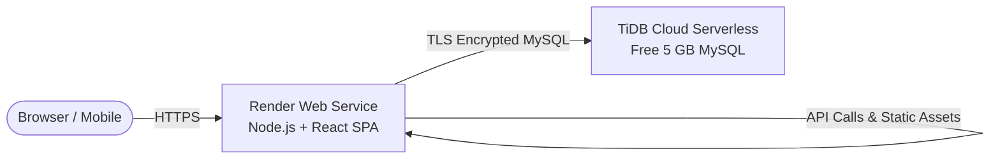

# Free & Hassle-Free Deployment Guide: Smart Mess

This guide shows how to deploy **Smart Mess** for **100% FREE** with **zero hosting fees** and **no credit card required**.

---

## Architecture Overview



### Why this is the easiest & most hassle-free approach:
1. **Single Web Service on Render**: Both the Vite React Frontend and Express Backend run on the **same service**.
2. **Zero CORS & Cookie Issues**: All `/api` routes and session cookies (`token`) run on the exact same origin (`https://your-app.onrender.com`).
3. **Automatic Database Setup**: Render runs `setup-db.js` on startup, automatically creating tables, running migrations, and creating the admin user in your cloud database.
4. **TiDB Cloud Serverless**: 100% MySQL compatible, 5 GB free forever, no credit card needed.

---

## Step 1: Create Free Cloud MySQL Database (TiDB Cloud)

> **Time required:** ~1 minute • **Cost:** $0 (Forever) • **Card:** Not required

1. Go to [https://tidbcloud.com](https://tidbcloud.com) and click **Sign Up** (or log in with GitHub/Google).
2. Choose **Serverless** cluster (Free forever, up to 5 GB storage).
3. Set a Cluster Name (e.g. `smart-mess-db`) and select any nearby AWS region.
4. Click **Create**.
5. Once created, click **Connect**:
   - Choose **Connect with**: `General` or `Node.js`.
   - Click **Generate Password** and copy the credentials:
     - **Host**: e.g., `gateway01.ap-southeast-1.prod.aws.tidbcloud.com`
     - **Port**: `4000`
     - **User**: e.g., `2AbcDefGhi.root`
     - **Password**: *(your generated password)*
     - **Database**: `test`

---

## Step 2: Push Changes to GitHub

Commit the deployment configuration updates and push to GitHub:

```bash
git add .
git commit -m "feat: configure zero-config free deployment for Render and cloud MySQL"
git push origin main
```

---

## Step 3: Deploy on Render

> **Time required:** ~2 minutes • **Cost:** $0 (Free Tier)

1. Go to [https://render.com](https://render.com) and sign in with your GitHub account.
2. In the Render Dashboard, click **New +** > **Web Service**.
3. Under **Connect a repository**, select your repository: `Rahul-Madesh/S5_mini_project`.
4. Configure the Web Service settings:

| Setting | Value |
|---|---|
| **Name** | `smart-mess` (or any name you like) |
| **Region** | Singapore / Frankfurt / Oregon (nearest to your TiDB region) |
| **Branch** | `main` |
| **Root Directory** | *(leave blank)* |
| **Runtime** | `Node` |
| **Build Command** | `npm run build` |
| **Start Command** | `npm run start` |
| **Instance Type** | **Free** |

5. Scroll down to **Environment Variables** and add the following:

| Key | Value | Description |
|---|---|---|
| `NODE_ENV` | `production` | Production mode |
| `JWT_SECRET` | `4f8e91a2b3c4d5e6f7a8b9c0d1e2f3a4b5c6d7e8f9a0` | Any 32+ character string |
| `DB_HOST` | *(Host from TiDB Cloud)* | e.g., `gateway01...tidbcloud.com` |
| `DB_PORT` | `4000` | Port from TiDB Cloud |
| `DB_USER` | *(User from TiDB Cloud)* | e.g., `xxxxxx.root` |
| `DB_PASSWORD` | *(Password from TiDB Cloud)* | Generated database password |
| `DB_NAME` | `test` | Database name from TiDB Cloud |
| `DB_SSL` | `true` | Enables secure TLS connection |
| `ADMIN_NAME` | `Mess Administrator` | Initial admin account name |
| `ADMIN_EMAIL` | `admin@mess.local` | Initial admin login email |
| `ADMIN_PASSWORD` | `AdminSecure2025!` | Strong admin password |
| `HOME_COLLEGE_NAME` | `Bannari Amman Institute of Technology` | College name |

*(Alternatively: You can replace the individual DB variables with a single `DATABASE_URL` if TiDB provided a connection string).*

6. Click **Deploy Web Service**!

---

## What Happens Automatically?

1. Render clones your repository.
2. Runs `npm run build`:
   - Installs all dependencies for backend & frontend.
   - Vite compiles the React frontend into production static assets (`frontend/dist`).
3. Runs `npm run start`:
   - Runs `setup-db.js`, connecting securely over SSL to TiDB Cloud.
   - Creates all tables (`users`, `polls`, `meal_responses`, `mess_menu`, etc.).
   - Inserts default poll options and seeds the admin account.
   - Starts Express server on the assigned port.
4. Your application is live at:
   `https://smart-mess.onrender.com`

---

## Verifying Your Deployment

1. Visit your live Render URL (`https://smart-mess.onrender.com`).
2. You will see the Smart Mess landing page.
3. Click **Login** and log in with the admin credentials:
   - **Email:** `admin@mess.local`
   - **Password:** `AdminSecure2025!` (or whatever you set in Render)
4. Check the API health check directly at:
   `https://smart-mess.onrender.com/api/health`
   Should return: `{"status":"healthy","service":"smart-mess-api",...}`

---

## Keeping It Free & Tips

- **Free Tier Sleep Behavior**: Render's free tier spins down after 15 minutes of inactivity. When a new visitor opens the URL, it takes about 30-45 seconds for the free instance to spin back up ("cold start"). This is standard for free cloud tiers.
- **Continuous Deployment**: Every time you `git push origin main`, Render will automatically rebuild and deploy your latest changes without you needing to do anything.
